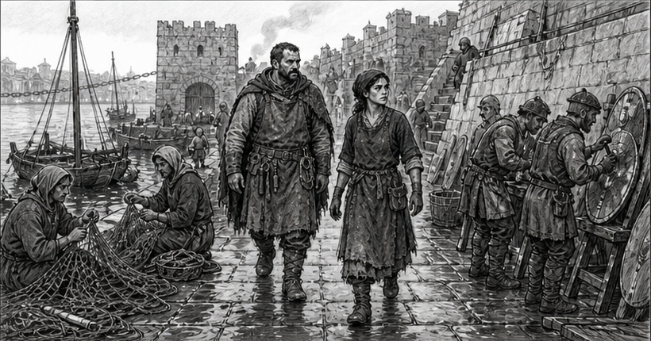
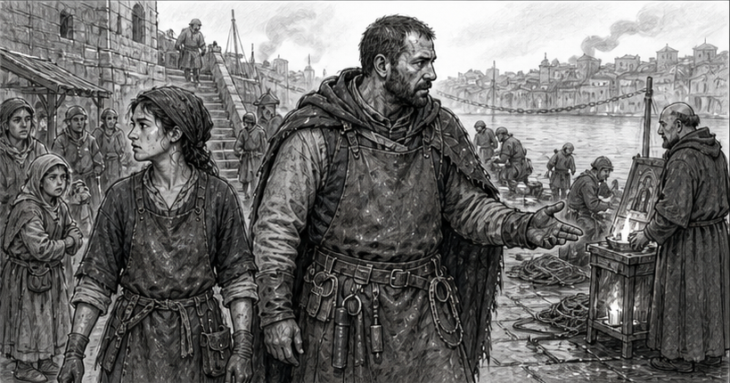
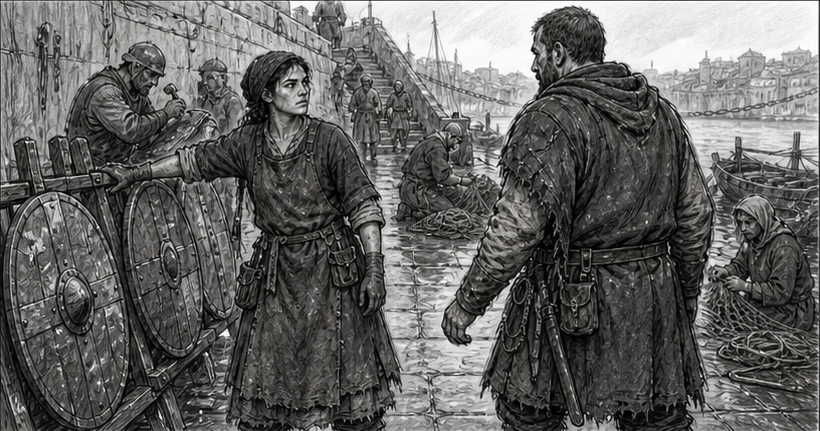
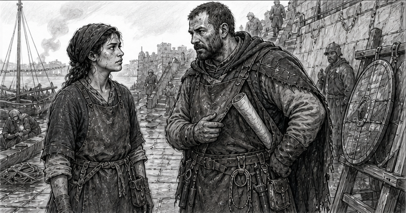
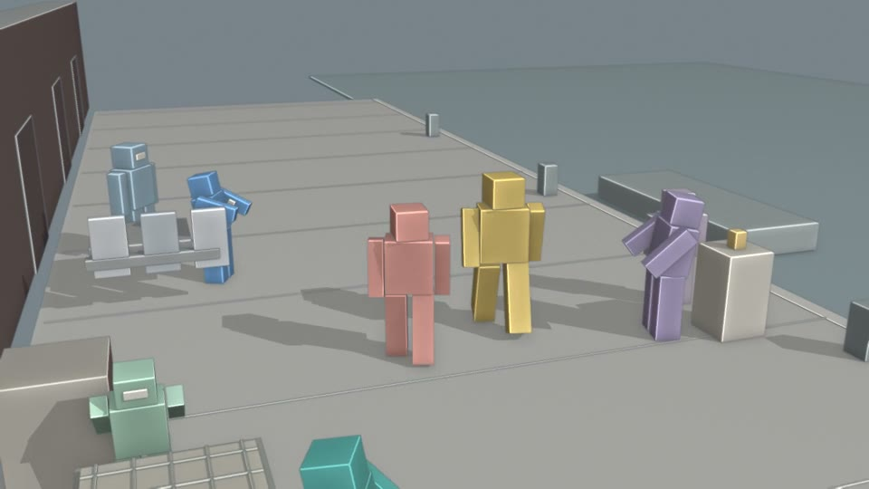
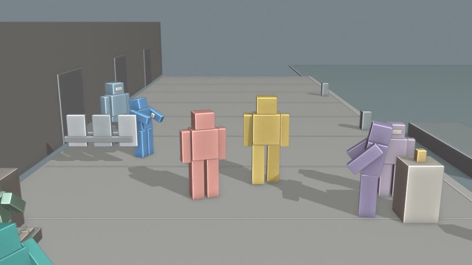
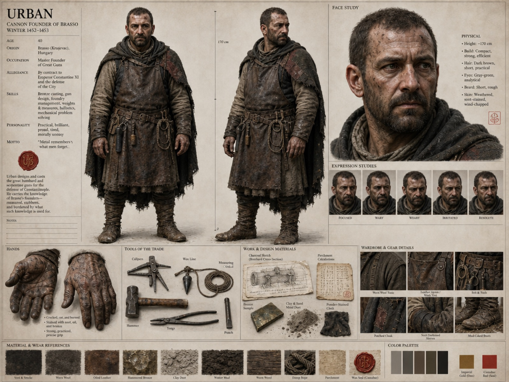
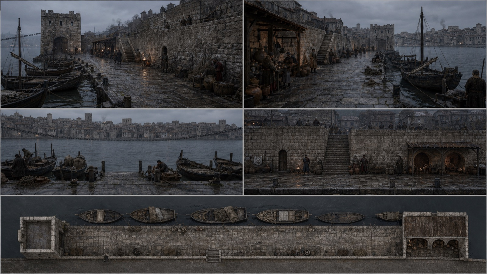
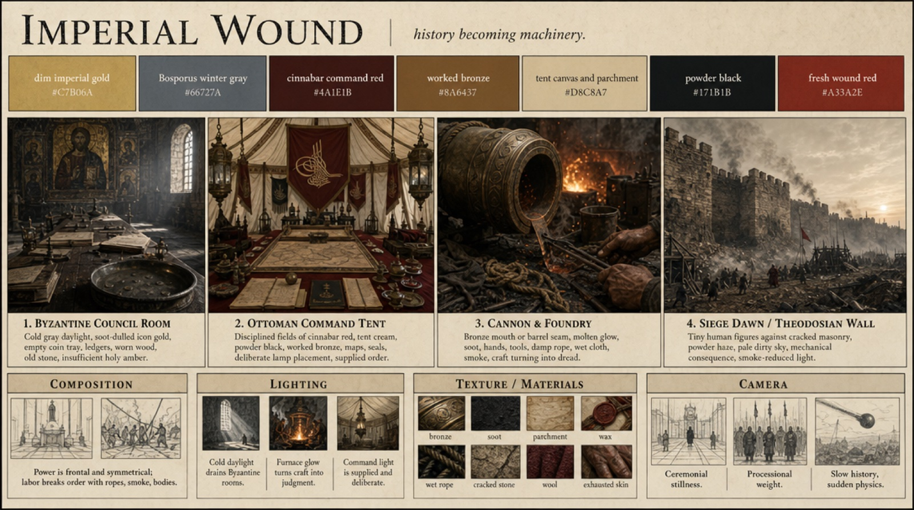
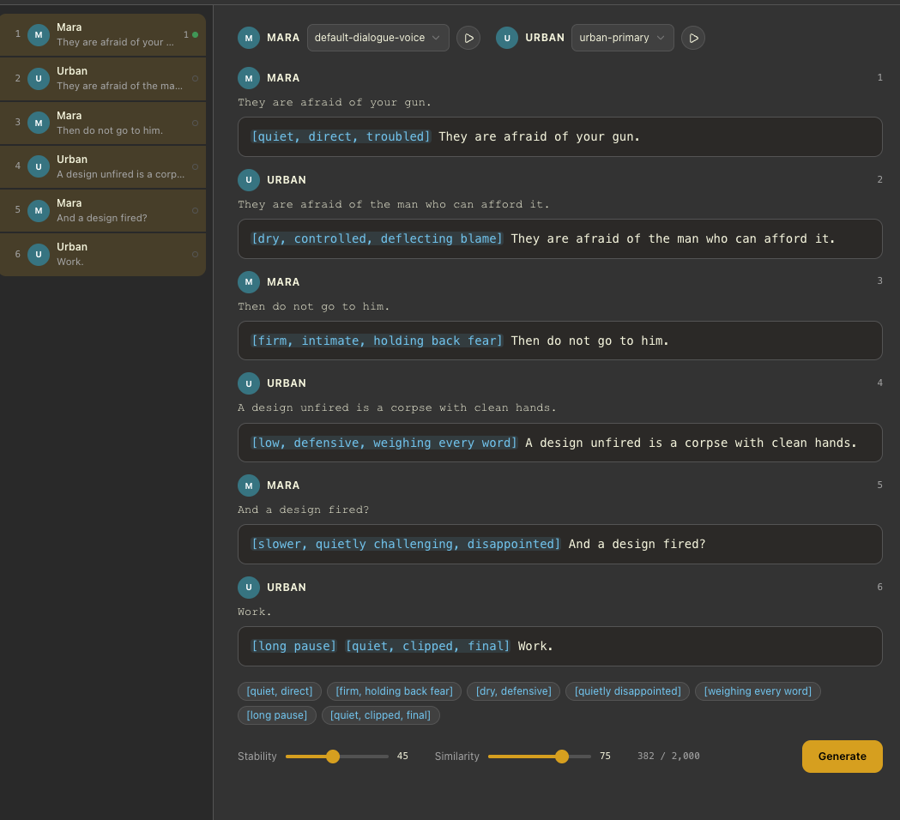

The home page now follows one scene from *Basilica*, the sample film made with Renku, all the way from the screenplay page to a generated take. This post covers the same scene in more detail: what each stage produced, and what it changed in the next one.

## The page

Scene 3, “The Harbor Argument”, is short. Urban, the cannon founder, walks through the harbor quarter of Constantinople with Mara. The city is repairing itself around them. They exchange four lines about whether Urban should sell his gun to the Ottoman Sultan:

> **Mara:** They are afraid of your gun. 
> **Urban:** They are afraid of the man who can afford it. 
> **Mara:** Then do not go to him. 
> **Urban:** A design unfired is a corpse with clean hands.

Across the water, Ottoman watchfires mark the far shore. The screenplay was written in Renku, so every later stage points back to these lines.

## Beats and storyboards

The scene was split into seven story Beats, starting with “A city mends around them” and ending with “Work”. Each Beat records what changes in it and why it matters, separately from any camera decision.

The storyboards went through four rounds, all made with Codex’s built-in image tool. Beats 1–4 come from the third round and Beats 5–7 from the fourth. The take covers the first four.

*Beats 1–4: “A city mends around them”, “Fear has a buyer”, “Mara stops the walk” and “The clean-handed corpse”.*

## Blender previs

Before any video was generated, the Blender Shot Planner staged the walk in Blender: where Urban and Mara stand, where the repair workers are, how the camera follows, and when each line lands. The previs went through three revisions. Revision 3, a single 17-second tracking shot, became the motion and camera reference for the take.

*The same moment in revision 1 (left) and revision 3 (right). Each colored figure stands in for one person: Mara is coral, Urban is ochre.*

## What the video model was given

The take was not made from one short sentence. The agent gave MiniMax H3 Max, running on fal.ai, five references: Mara’s and Urban’s character sheets, the Harbor Quarter location sheet, the “Imperial Wound” production lookbook sheet for the overall look, and a 15-second cut of previs revision 3 for motion, staging and camera.

*Three of the five references: Urban’s character sheet, the Harbor Quarter location sheet and the “Imperial Wound” lookbook sheet.*

Alongside them the agent wrote about 1,000 words of direction. That text says which reference controls what, sets the camera height and lens, and times each line to the second. A short extract:

> Video 1 is the authoritative camera, staging, screen-direction, relative-position, movement and timing reference. […] Images 1–4 control appearance; Video 1 controls action and camera.

The result is a 15-second take with voices and sound generated together with the picture.

## What didn’t work

The first take had no audio reference, so the video model invented the voices along with the picture. Without a voice to follow, the voices were not consistent, and there was no way to direct how each line was delivered.

For the second take, the dialogue came first. ElevenLabs v4 generated all six lines of the scene as one recording, using a chosen voice for each character and a short delivery note on every line. That recording went to the video model as an audio reference, together with the previs, the location sheet, newer character sheets for Mara and Urban, and a frame from the first take to carry over its photographic finish. The voices stayed consistent and the acting improved, and the take now covers all six lines of the scene.

*Directing the dialogue before generating it. Each line gets a delivery note, and each character keeps one voice.*

The recording was 1.5 seconds too long for a 15-second take. Rather than speed up the speech, one pause near the end was shortened.

[Watch the second take, hear the dialogue recording and read its full direction on the home page →](/#made-with-renku)
